# @keyframerdev/wizard



In your app's folder:

```sh
npx @keyframerdev/wizard
```

The wizard asks a few questions, shows every change as a diff before it writes it, installs what is missing, and ends by waiting for your app to say hello. It works with Expo (Expo Go included) and bare React Native, TypeScript or JavaScript, npm, pnpm, yarn and bun, and apps inside a monorepo. For iOS, Android and Flutter apps, follow their pages: [iOS](ios.md), [Android](android.md), [Flutter](flutter.md).

## What it does

### 1. Looks at your app

Expo or bare React Native, the package manager (from the lockfile, also at a monorepo's root), the Babel config, the entry file, and whether you use expo-router or React Navigation. If git has uncommitted changes, it says so first: committing before makes its changes easy to review or undo.

### 2. Asks what to set up

The Inspector, Motion Vitals, or both.

### 3. Asks where you want to see the Inspector

- **Expo's dev tools**: press shift+m in Metro. No account. The default for Expo apps.
- **The desktop app**, Keyframer Inspector (macOS). If it isn't installed, the wizard offers to download the latest signed build from [GitHub Releases](https://github.com/keyframer-dev/inspector/releases/latest), checks its signature and Gatekeeper, installs it, opens it, and points your app at its relay (port 8790). It asks first, and with `--yes` it only installs with `--install-desktop`.
- **The Keyframer editor**, with the pairing code its Inspector panel shows.

### 4. Finds your Motion Vitals key

The way you choose:

- **Sign in with the browser.** It opens keyframer.dev, you approve a code, and it picks or creates the workspace and the project (named after your app) and reads or creates the project's field key.
- **Paste a key** from your project's Setup page.

### 5. Shows each change as a diff

Then asks before writing it:

- **Packages**: `@keyframerdev/inspector` as a dev dependency, `@keyframerdev/vitals`, and anything they need that is missing (Reanimated 4 and `react-native-worklets`), with `npx expo install` in Expo apps so versions match your SDK.
- **Babel**: the plugins go before `react-native-worklets/plugin`, the Inspector's in development only. With no Babel config yet, it creates the one these docs show.
- **One file of its own**, `keyframer.ts` (or `.js`), next to your entry or in `src/`, never in expo-router's `app/` folder, where every file is a route. It starts the Inspector in development only (required inside `if (__DEV__)`, so release builds don't include it) and Motion Vitals in every build.
- **One import, or one hook call**, in your entry or root layout.
- **`<VitalsRoot>`** around your app, if you want it, so lists without scroll handlers are measured too.

### 6. Sets up your coding agents

If you want: the Inspector's MCP server in `.mcp.json` (Claude Code) and `.cursor/mcp.json` (Cursor), merged with what is there.

### 7. Checks that it works

Start or reload your app, and the wizard waits for it:

- **Inspector**: the app's hello, where you chose to see it. Only your app counts: it asks each Metro which project it serves, and leaves the others alone.
- **Motion Vitals**: the first session at keyframer.dev. A development build sends its session when the app goes to the background, so the wizard asks you to move something and then send the app to the background (in the iOS Simulator, shift+cmd+H). New projects ignore development builds; when you signed in, it offers to keep them, so a simulator run counts.

Running it again changes nothing that is already in place, so it is also the quickest way to check the setup later.

## Navigation

Motion Vitals names screens from your navigation container's ref, and the Inspector marks screen changes in recordings.

- **expo-router**: the root layout gets `useNavigationContainerRef()` from `expo-router` and passes it to the wizard's `useKeyframer` hook.
- **React Navigation**: if your `<NavigationContainer>` has no ref, the wizard adds `ref={navigationRef}`, made with `createNavigationContainerRef()` in its file. If it has one, it reuses yours.
- **When it can't tell** (no container, several, or one inside your own wrapper component), it changes nothing there and prints the snippet to paste, with the file and line to put it at.

## Without questions: agents and CI

`--yes` takes the defaults and stops with exit code 2, naming the flag, where a question has no default:

```sh
# The Inspector, in Expo's dev tools
npx @keyframerdev/wizard --yes --products inspector --view devtools

# Both, with the Vitals key in hand
npx @keyframerdev/wizard --yes --products inspector,vitals --view devtools --key kfp_live_…

# See every change first: nothing is written or installed
npx @keyframerdev/wizard --dry-run --yes --products inspector --view devtools
```

Without `--key`, `--yes` doesn't try a browser sign-in nobody can approve: it asks for `--key` (or `--auth browser`, when someone is at the browser).

## Options

| Option | What it does |
|---|---|
| `--products <list>` | `inspector`, `vitals`, or `inspector,vitals`. Default: ask; with `--yes`, the Inspector, plus Vitals when `--key` is given |
| `--view <view>` | Where to see the Inspector: `devtools`, `desktop` or `editor` |
| `--code <code>` | The pairing code the editor's Inspector panel shows (`--view editor`) |
| `--key <kfp_live_…>` | The Motion Vitals project's field key |
| `--auth paste`, `--auth browser` | How to find the Vitals key without `--key`: paste it, or sign in through the browser |
| `--vitals-root` | Wrap the app in `<VitalsRoot>` (`--no-vitals-root`: don't) |
| `--root <dir>` | The app's folder (default: the current folder). In a monorepo, the app's own folder |
| `--metro <url>` | Metro's address when it isn't on ports 8081 to 8090 |
| `--agents <list>` | Set up these agents' MCP config: `claude-code`, `cursor` |
| `--no-agents` | Don't offer the agent integrations |
| `--dry-run` | Show every change; write and install nothing |
| `--skip-install` | Print the install commands instead of running them |
| `--skip-verify` | Don't wait for the app's first message |
| `--install-desktop` | Download and install the desktop app if it's missing, without asking. Unattended runs don't install it otherwise |
| `--api <url>`, `--app <url>` | Other Keyframer servers (or `KEYFRAMER_API_URL`, `KEYFRAMER_APP_URL`) |
| `--yes`, `-y` | No questions |

Exit codes: 0 done, 1 failed, 2 bad usage (or a question `--yes` can't answer), 130 cancelled.

## When no hello comes

The wizard waits three minutes, then says what it saw, and the usual causes:

- **Metro for this project is running, but the app never said hello**: reload the app (press r in Metro). Expo Go may still show an app it had open before: close it and open this project again.
- **Metro answered only for other projects**: start this project's Metro (`npx expo start`), or pass `--metro`.
- **No Metro answered**: start it in this project.
- **An Android emulator** reaches Metro and the desktop relay through adb: `adb reverse tcp:8081 tcp:8081` (and `tcp:8790 tcp:8790` for the desktop app).
- **A physical device** joins the desktop app at your Mac's LAN address, which the desktop app shows in its status bar.

Your setup is done either way: run the wizard again any time to check.

## Undo

Everything it wrote is in your diff: the Babel config, the wizard's `keyframer.ts`, one import or hook call (and `<VitalsRoot>` or the container's ref, when it added them), the agents' MCP config, and the packages in `package.json`. To take it out, restore the files it changed (`git restore <file>`), delete the ones it created, and remove `@keyframerdev/inspector` and `@keyframerdev/vitals` with your package manager.

The steps it takes, by hand: [React Native and Expo](react-native.md) for the Inspector, [Motion Vitals for React Native](../vitals/react-native.md).
